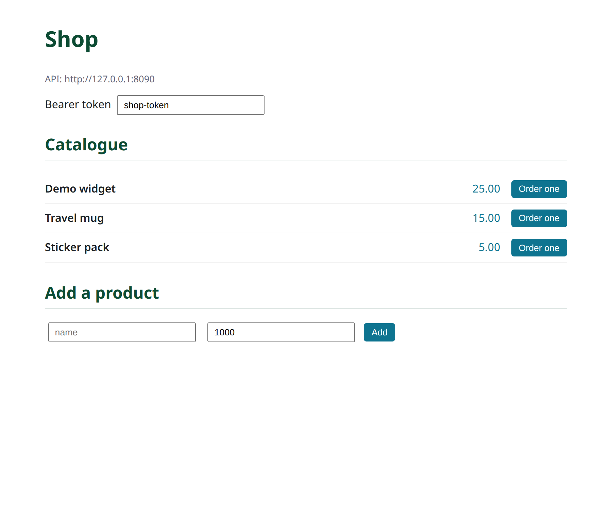

# Part 11: A separate dxjs frontend, over CORS

The admin console (Part 10) is the back office. For a **customer-facing
storefront** you usually want a bespoke single-page app, deployed **separately**
from the API — its own origin, its own release cadence, maybe its own CDN. This
part builds that storefront with [**dxjs**](https://github.com/ngolacloud/dxjs)
(the Delonix reactive UI engine) and shows the one backend change a separate origin
requires: **CORS**.

!!! note "dxjs is the frontend engine; `dx` is the package manager"
    [`dx`](../../dx/index.md) builds your Rust project; **dxjs** is a TypeScript UI
    library (signals, no virtual DOM). Unrelated beyond the family name.

## Two origins, one API

In development the SPA runs on, say, `http://localhost:5173` and the shop API on
`http://127.0.0.1:8090`. A browser will refuse the cross-origin calls unless the
API opts the SPA's origin in — that is what CORS is for. Seiva mounts a CORS layer
**only when you list origins** (otherwise same-origin stays locked down, ADR API8):

```rust
// apps/shop-api/src/main.rs — allow the storefront's origin
let security = HttpSecurity::with_cors_origins(["http://localhost:5173", "https://shop.example"]);

let app = router_with_modules(health, &security, Some(auth), modules);
```

With that set, `seiva-http` answers CORS preflight (`OPTIONS`) and adds the
`Access-Control-Allow-Origin` headers for exactly those origins — no wildcard, no
accidental exposure. Nothing else about the modules changes; the same contract,
now reachable from another origin.

## The storefront

The SPA points its client at the API origin and consumes the same routes the
Swagger page showed (Part 7) — browse the catalogue (`GET /v1/catalogs`) and place
an order (`POST /v1/orders/place`):

```ts
import { html } from "@dxjs/dom";
import { component, mount } from "@dxjs/component";
import { createClient, resource } from "@dxjs/transport";

// Cross-origin: the API lives on another host, so baseUrl is absolute.
const api = createClient({ baseUrl: "http://127.0.0.1:8090" });

const Storefront = component(() => {
  const products = resource((sig) => api.get("/v1/catalogs", { signal: sig }));
  return html`
    <h1>Shop</h1>
    <ul>
      ${() => (products() ?? []).map((p) => html`
        <li>${p.name} — ${() => (p.price_cents / 100).toFixed(2)}</li>`)}
    </ul>`;
});
mount(Storefront, document.querySelector("#app"), {});
```

A write carries the bearer in the `Authorization` header (never a cookie, so there
is no CSRF surface and no `credentials: include` needed):

```ts
api.post("/v1/orders/place",
  { customer, lines },
  { headers: { authorization: "Bearer " + token } });
```

The backend still runs the whole order flow (Part 3) and enforces `orders.manage`
(Part 5); the SPA holds no business rules.

## Where the code lives

```text
apps/shop-api/src/main.rs    # HttpSecurity::with_cors_allowed_origins([...])
storefront/                  # the separate dxjs app (its own repo or folder)
  └── src/main.ts            # createClient({ baseUrl: "<api-origin>" }) + mount
```

## Build and test (two processes)

The finished storefront is
[`examples/shop-storefront`](https://github.com/ngolacloud/seiva/tree/main/examples/shop-storefront)
— a runnable dxjs app bundled with esbuild. Run the API with CORS on, then build
and serve the SPA on its own origin:

```console
# terminal 1 — the API, allowing the storefront's origin
$ SHOP_API_CORS_ORIGINS=http://127.0.0.1:5173 cargo run -p shop-api

# terminal 2 — build + serve the storefront (Node ≥ 22; dxjs from the sibling repo)
$ cd examples/shop-storefront
$ node build.mjs            # esbuild → dist/app.js
$ node serve.mjs           # http://127.0.0.1:5173
```

Confirm the preflight is allowed:

```console
$ curl -s -i -X OPTIONS localhost:8090/v1/catalogs \
    -H 'Origin: http://127.0.0.1:5173' \
    -H 'Access-Control-Request-Method: GET' | grep -i access-control-allow-origin
access-control-allow-origin: http://127.0.0.1:5173
```

Open <http://127.0.0.1:5173>: the catalogue is fetched **cross-origin** from the
API and rendered by dxjs; you can add a product and place an order.



## Live-reload, both sides

`seiva start --watch` reloads the API on save; `node --watch` reloads the SPA. Edit
a facade and the storefront sees the new route after a refresh — the contract keeps
the two honest.

## You used the whole of Seiva

From a modular monolith to microservices, with events, a typed data layer,
deny-by-default authorization, CQRS, auto-generated OpenAPI/Swagger, an admin
console and a decoupled SPA — one contract per module drove all of it. That is the
shape of a complex, cloud-native system built on Seiva.

Where next: the [topic guides](../../topics/index.md), the [DORM section](../../dorm/index.md),
and the [dx section](../../dx/index.md).

---

*Part of the [Seiva documentation](../../index.md).*
