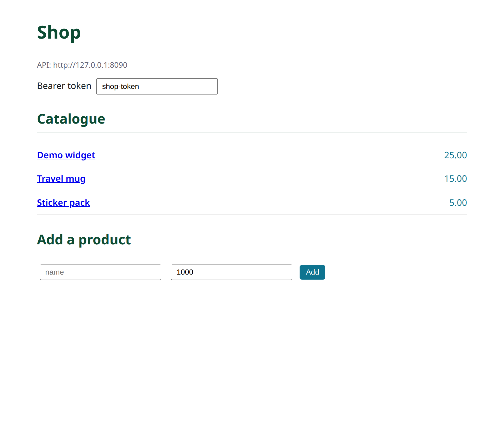
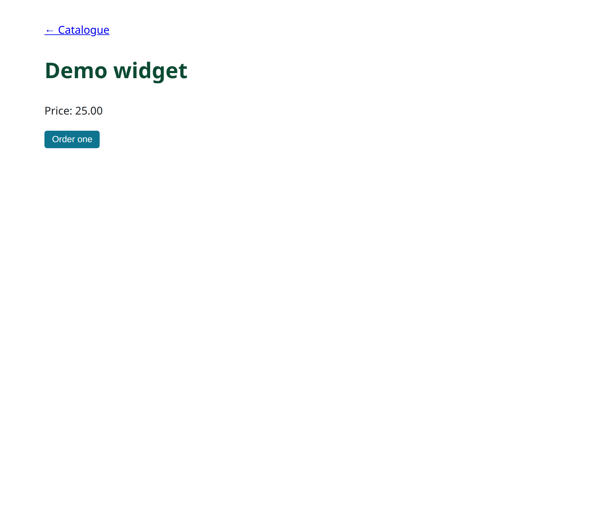

# Parte 11: Um frontend dxjs separado, sobre CORS

A consola admin (Parte 10) é o back office. Para uma **montra virada ao cliente**
queres normalmente uma single-page app à medida, deployada **separadamente** da
API — a sua própria origem, a sua própria cadência de release, talvez a sua própria
CDN. Esta parte constrói essa montra com [**dxjs**](https://github.com/ngolacloud/dxjs)
(o motor de UI reactivo da Delonix) e mostra a única mudança no backend que uma
origem separada exige: **CORS**.

!!! note "dxjs é o motor de frontend; `dx` é o gestor de pacotes"
    [`dx`](../../dx/index.md) constrói o teu projecto Rust; **dxjs** é uma
    biblioteca de UI em TypeScript (signals, sem DOM virtual). Sem relação para
    além do nome de família.

## Duas origens, uma API

Em desenvolvimento a SPA corre, digamos, em `http://localhost:5173` e a API da loja
em `http://127.0.0.1:8090`. Um navegador vai recusar as chamadas entre origens a
menos que a API aceite a origem da SPA — é para isso que serve o CORS. O Seiva monta
uma camada CORS **apenas quando listas origens** (caso contrário a mesma origem fica
trancada, ADR API8):

```rust
// apps/shop-api/src/main.rs — allow the storefront's origin
let security = HttpSecurity::with_cors_origins(["http://localhost:5173", "https://shop.example"]);

let app = router_with_modules(health, &security, Some(auth), modules);
```

Com isso definido, `seiva-http` responde ao preflight CORS (`OPTIONS`) e adiciona os
cabeçalhos `Access-Control-Allow-Origin` para exactamente essas origens — sem
wildcard, sem exposição acidental. Nada mais acerca dos módulos muda; o mesmo
contrato, agora alcançável a partir de outra origem.

## A montra

A SPA aponta o seu cliente para a origem da API e consome as mesmas rotas que a
página Swagger mostrou (Parte 7) — navegar o catálogo (`GET /v1/catalogs`) e colocar
uma encomenda (`POST /v1/orders/place`):

```ts
import { html } from "@dxjs/dom";
import { component, mount } from "@dxjs/component";
import { createClient, resource } from "@dxjs/transport";

// Cross-origin: the API lives on another host, so baseUrl is absolute.
const api = createClient({ baseUrl: "http://127.0.0.1:8090" });

const Storefront = component(() => {
  const products = resource((sig) => api.get("/v1/catalogs", { signal: sig }));
  return html`
    <h1>Shop</h1>
    <ul>
      ${() => (products() ?? []).map((p) => html`
        <li>${p.name} — ${() => (p.price_cents / 100).toFixed(2)}</li>`)}
    </ul>`;
});
mount(Storefront, document.querySelector("#app"), {});
```

Uma escrita carrega o bearer no cabeçalho `Authorization` (nunca um cookie, por isso
não há superfície CSRF nem `credentials: include` necessário):

```ts
api.post("/v1/orders/place",
  { customer, lines },
  { headers: { authorization: "Bearer " + token } });
```

O backend continua a correr o fluxo da encomenda inteiro (Parte 3) e impõe
`orders.manage` (Parte 5); a SPA não guarda regras de negócio.

## Onde vive o código

```text
apps/shop-api/src/main.rs    # HttpSecurity::with_cors_allowed_origins([...])
storefront/                  # the separate dxjs app (its own repo or folder)
  └── src/main.ts            # createClient({ baseUrl: "<api-origin>" }) + mount
```

## Construir e testar (dois processos)

A montra terminada é a
[`examples/shop-storefront`](https://github.com/ngolacloud/seiva/tree/main/examples/shop-storefront)
— uma app dxjs que corre, empacotada com esbuild. Corre a API com CORS ligado,
depois constrói e serve a SPA na sua própria origem:

```console
# terminal 1 — a API, a permitir a origem da montra
$ SHOP_API_CORS_ORIGINS=http://127.0.0.1:5173 cargo run -p shop-api

# terminal 2 — construir + servir a montra (Node ≥ 22; dxjs do repo irmão)
$ cd examples/shop-storefront
$ node build.mjs            # esbuild → dist/app.js
$ node serve.mjs           # http://127.0.0.1:5173
```

Confirma que o preflight é permitido:

```console
$ curl -s -i -X OPTIONS localhost:8090/v1/catalogs \
    -H 'Origin: http://127.0.0.1:5173' \
    -H 'Access-Control-Request-Method: GET' | grep -i access-control-allow-origin
access-control-allow-origin: http://127.0.0.1:5173
```

Abre <http://127.0.0.1:5173>: o catálogo é obtido **cross-origin** da API e
renderizado pelo dxjs; podes adicionar um produto e colocar uma encomenda.



## Routing no cliente

Uma montra tem mais do que um ecrã. O `@dxjs/component` traz um pequeno router de
History-API; a montra usa-o para uma vista de catálogo (`/`) e uma vista de detalhe
de produto (`/product/:id`), trocando o componente montado num outlet ao navegar:

```ts
import { createRouter } from "@dxjs/component";

const router = createRouter(
  [
    { path: "/", component: Catalogue },
    { path: "/product/:id", component: ProductView }, // ctx.params.id
  ],
  { fallback: "/" },
);
router.outlet(document.querySelector("#app")!);
```

Clicar num produto chama `router.navigate("/product/" + id)`; a vista de detalhe lê
`ctx.params.id`, busca `GET /v1/catalogs/{id}` e renderiza-o:



!!! note "Os ids viajam no fio como strings"
    Um id de produto é um valor de 128 bits — maior do que o inteiro seguro do
    JavaScript (2⁵³). Por isso os DTOs da loja serializam os ids como **strings
    JSON**, para o browser os manter intactos e um deep link como
    `/product/1794005853720908638` resolver exactamente. (O parâmetro de caminho do
    URL continua a ser parseado como `u128` no servidor.)

A servir a SPA, o servidor estático faz fallback para `index.html` em caminhos sem
extensão, para um deep link em `/product/:id` carregar e o router o resolver.

## Live-reload, dos dois lados

`seiva start --watch` recarrega a API ao gravar; `node --watch` recarrega a SPA.
Edita uma fachada e a montra vê a nova rota após um refresh — o contrato mantém os
dois honestos.

## Usaste o Seiva por inteiro

De um monólito modular a microserviços, com eventos, uma camada de dados tipada,
autorização por negação por omissão, CQRS, OpenAPI/Swagger auto-gerado, uma consola
admin e uma SPA desacoplada — um contrato por módulo conduziu tudo isto. É este o
formato de um sistema complexo e cloud-native construído sobre o Seiva.

Para onde a seguir: os [guias de tópicos](../../topics/index.md), a
[secção DORM](../../dorm/index.md), e a [secção dx](../../dx/index.md).

---

*Parte da [documentação do Seiva](../../index.md).*
