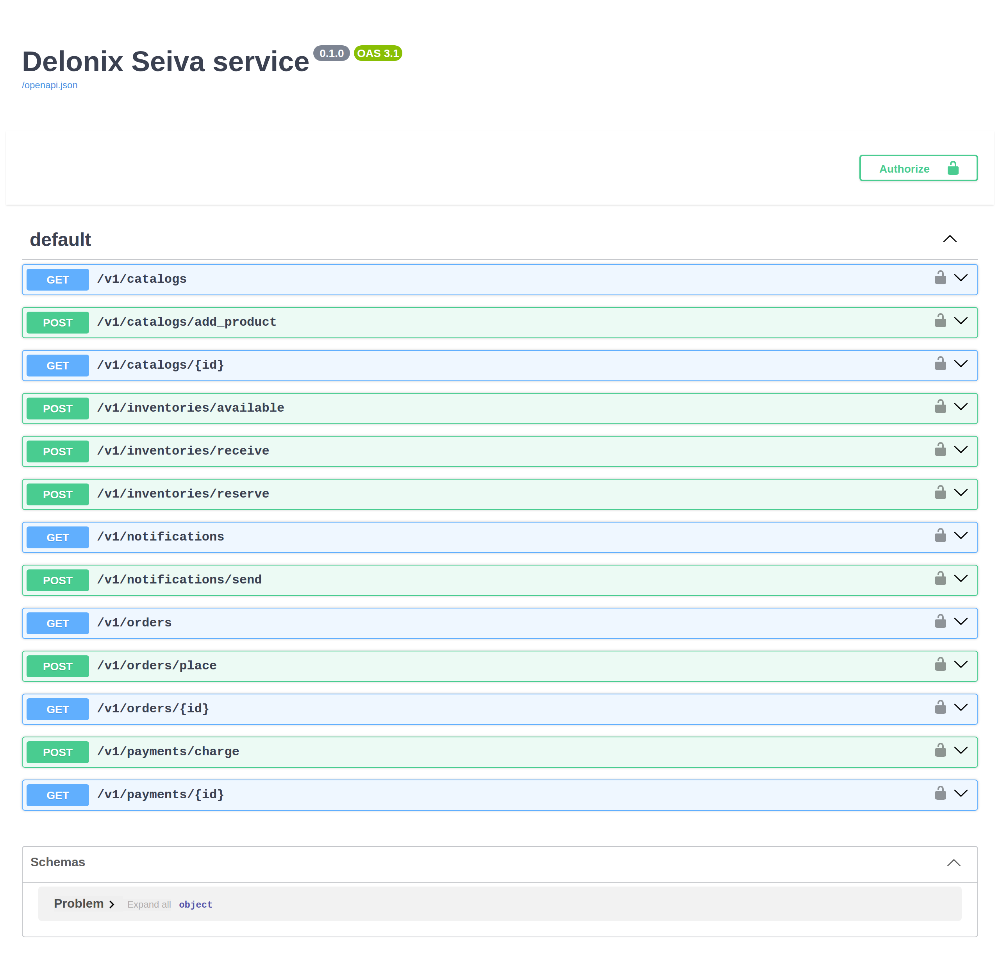
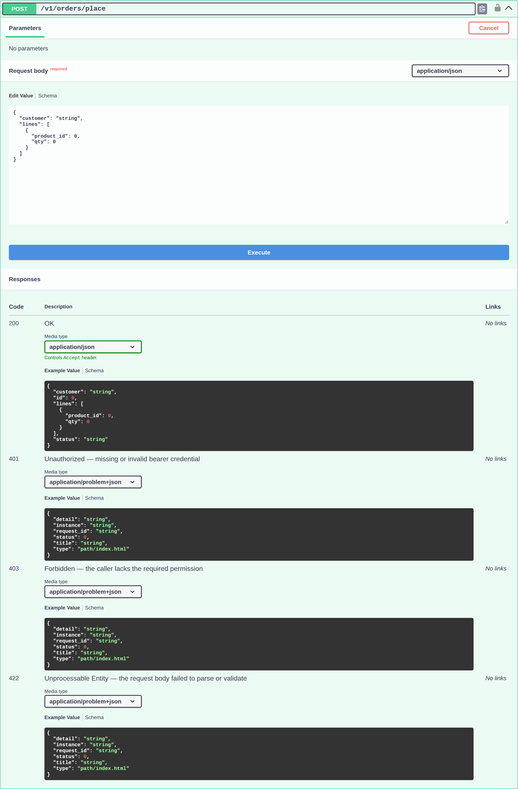

# Part 7: Auto-generated API docs & Swagger

You have not written a line of OpenAPI, yet the shop already has a complete,
accurate API document — and an interactive Swagger UI to explore it. In Seiva the
docs are **derived from the facade contract**, the same way the routes and the
permission guards are (Part 2). Add a method or a DTO field and the docs follow;
there is nothing to keep in sync, because there is only one source of truth.

## Run the shop and open the docs

The repository composes the five modules into a runnable service,
[`apps/shop-api`](https://github.com/ngolacloud/seiva/tree/main/apps/shop-api)
(it is what your own `apps/shop-api` composition root becomes). Run it and open
`/docs`:

```console
$ cargo run -p shop-api          # serves http://127.0.0.1:8090
# then open http://127.0.0.1:8090/docs
```

Three documentation surfaces are served, all from the same generated document:

- `/openapi.json` — the OpenAPI 3.1 document.
- `/docs` — **Swagger UI**.
- `/redoc` and `/scalar` — ReDoc and Scalar, if you prefer them.

## Every module, documented — no spec written

Swagger UI lists every route the five modules expose, grouped and typed, straight
from the contracts:



Each route came from a `#[seiva::facade]` method: `POST /v1/orders/place` from
`Orders::place`, `GET /v1/catalogs/{id}` from `Catalog::get`, and so on. The HTTP
method, the path and the version (`v1`) are read from the descriptor — you wrote no
routing and no annotations.

## Each business flow generates its full schema

Expand `POST /v1/orders/place` and the whole contract for that flow is there — the
request body schema (a `customer` plus a list of order `lines`, derived from the
`PlaceOrder` DTO via `WireSchema`), the `200` response shape (`OrderDto`), and the
error responses as RFC 9457 problems:



- The **request body** is the real DTO — add a field to `PlaceOrder` and it appears
  here on the next build, with no serializer to edit (ADR 0007).
- The **`401` / `403` / `422`** responses are generated from the guard and the
  validator: a missing bearer is `401`, a caller without `orders.manage` is `403`,
  and a body that fails `Validate` is a `422` `problem+json`. The contract
  documents how the route *actually* behaves, because the same descriptor drives
  both the behaviour and the document.

This is the FastAPI-style "the code is the spec" experience — as a compiled,
no-reflection binary.

## Where the code lives

Nothing to write for the docs. They come from the contracts you already have:

```text
modules/<module>/facade/src/lib.rs   # the #[seiva::facade] trait + WireSchema DTOs
apps/shop-api/src/main.rs            # composes the modules; seiva-server serves /openapi.json + /docs
```

## Build and test

```console
$ cargo run -p shop-api &                       # boot the service
$ curl -s localhost:8090/openapi.json | jq '.paths | keys'   # every route, generated
$ curl -s -o /dev/null -w '%{http_code}\n' localhost:8090/docs   # 200 — Swagger UI
```

## Live-reload while you work

```console
$ seiva start --watch        # edit a facade, refresh /docs — the new route is already there
```

## Next

[Part 8: Testing the shop](part-8-testing.md).

---

*Part of the [Seiva documentation](../../index.md).*
