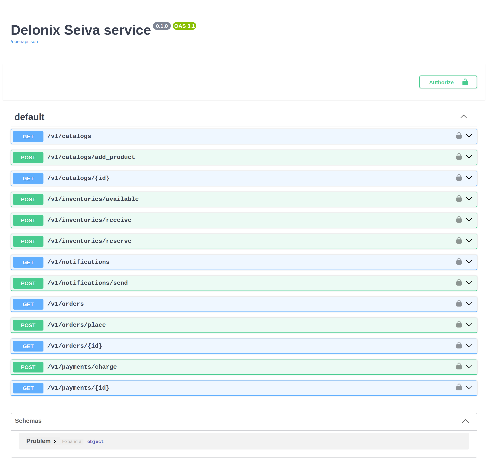
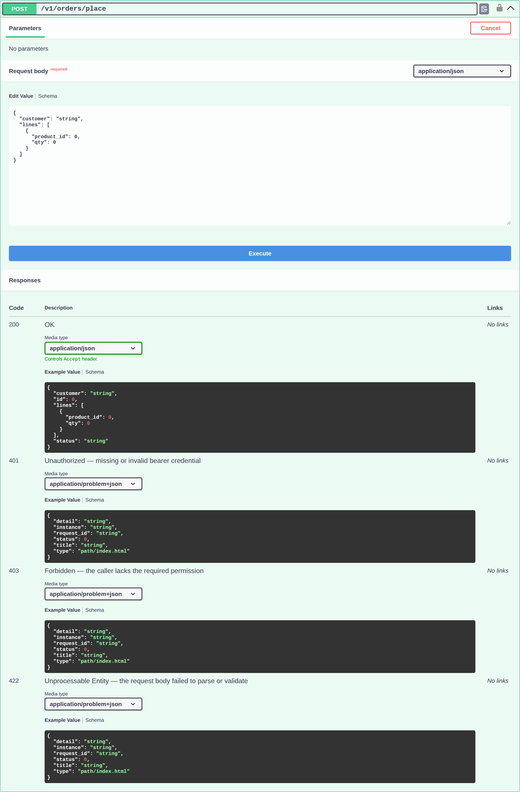

# Parte 7: Documentação de API auto-gerada & Swagger

Não escreveste uma linha de OpenAPI, e no entanto a loja já tem um documento de API
completo e exacto — e uma Swagger UI interactiva para o explorar. No Seiva os docs
são **derivados do contrato da fachada**, da mesma forma que as rotas e as guardas
de permissão (Parte 2). Adiciona um método ou um campo de DTO e os docs seguem; não
há nada a manter sincronizado, porque só existe uma fonte de verdade.

## Correr a loja e abrir os docs

O repositório compõe os cinco módulos num serviço executável,
[`apps/shop-api`](https://github.com/ngolacloud/seiva/tree/main/apps/shop-api) (é
no que a tua própria raiz de composição `apps/shop-api` se torna). Corre-o e abre
`/docs`:

```console
$ cargo run -p shop-api          # serves http://127.0.0.1:8090
# then open http://127.0.0.1:8090/docs
```

São servidas três superfícies de documentação, todas a partir do mesmo documento
gerado:

- `/openapi.json` — o documento OpenAPI 3.1.
- `/docs` — **Swagger UI**.
- `/redoc` e `/scalar` — ReDoc e Scalar, se os preferires.

## Cada módulo, documentado — sem especificação escrita

A Swagger UI lista cada rota que os cinco módulos expõem, agrupada e tipada, directa
dos contratos:



Cada rota veio de um método `#[seiva::facade]`: `POST /v1/orders/place` de
`Orders::place`, `GET /v1/catalogs/{id}` de `Catalog::get`, e assim por diante. O
método HTTP, o caminho e a versão (`v1`) são lidos do descritor — não escreveste
encaminhamento nem anotações.

## Cada fluxo de negócio gera o seu schema completo

Expande `POST /v1/orders/place` e o contrato inteiro para esse fluxo está ali — o
schema do corpo do pedido (um `customer` mais uma lista de `lines` de encomenda,
derivado do DTO `PlaceOrder` via `WireSchema`), o formato da resposta `200`
(`OrderDto`), e as respostas de erro como problemas RFC 9457:



- O **corpo do pedido** é o DTO real — adiciona um campo a `PlaceOrder` e ele
  aparece aqui na próxima build, sem serializador a editar (ADR 0007).
- As respostas **`401` / `403` / `422`** são geradas a partir da guarda e do
  validador: um bearer em falta é `401`, um chamador sem `orders.manage` é `403`, e
  um corpo que falha `Validate` é um `422` `problem+json`. O contrato documenta como
  a rota *realmente* se comporta, porque o mesmo descritor conduz tanto o
  comportamento como o documento.

Esta é a experiência estilo FastAPI de "o código é a especificação" — como um
binário compilado, sem reflexão.

## Onde vive o código

Nada a escrever para os docs. Vêm dos contratos que já tens:

```text
modules/<module>/facade/src/lib.rs   # the #[seiva::facade] trait + WireSchema DTOs
apps/shop-api/src/main.rs            # composes the modules; seiva-server serves /openapi.json + /docs
```

## Construir e testar

```console
$ cargo run -p shop-api &                       # boot the service
$ curl -s localhost:8090/openapi.json | jq '.paths | keys'   # every route, generated
$ curl -s -o /dev/null -w '%{http_code}\n' localhost:8090/docs   # 200 — Swagger UI
```

## Live-reload enquanto trabalhas

```console
$ seiva start --watch        # edit a facade, refresh /docs — the new route is already there
```

## Seguinte

[Parte 8: Testar a loja](part-8-testing.md).

---

*Parte da [documentação do Seiva](../../index.md).*
